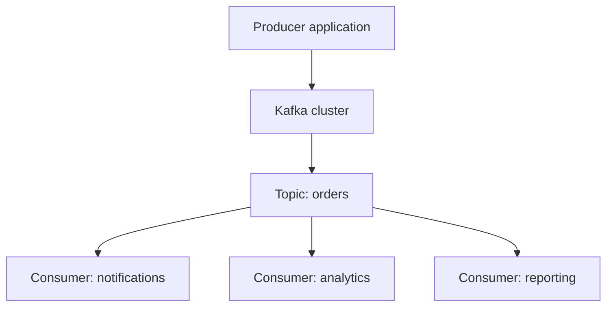
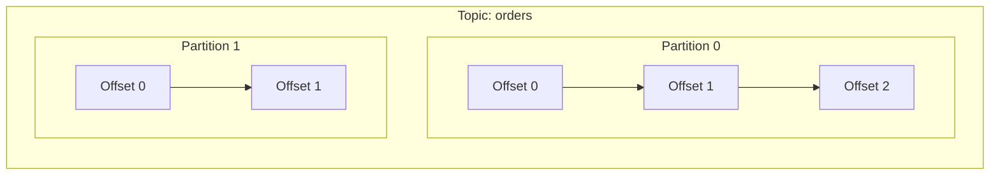
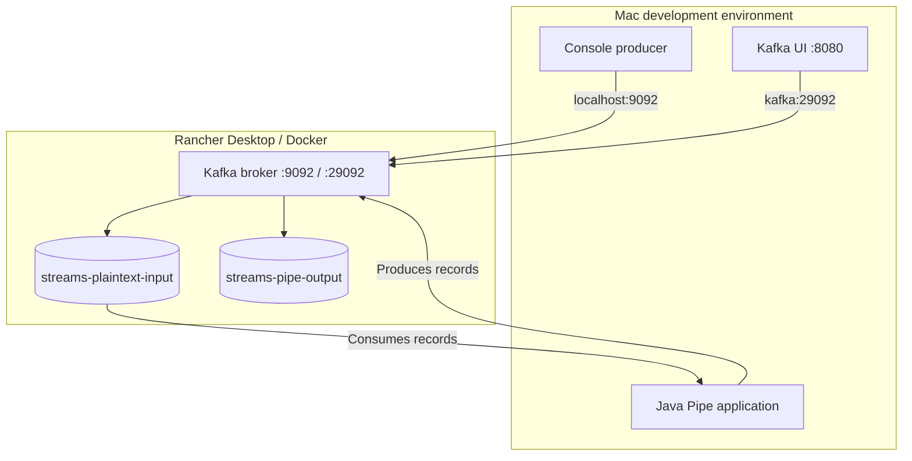
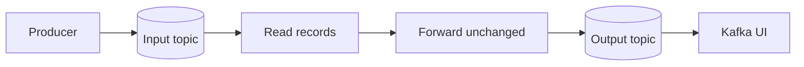
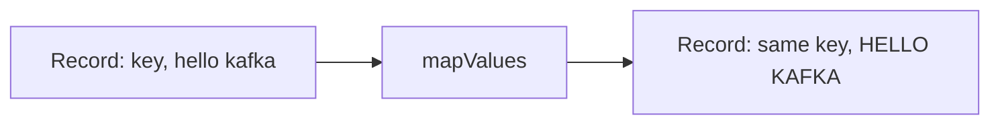
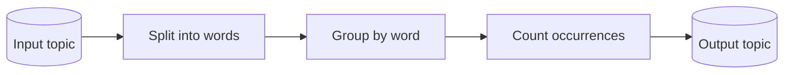

# Apache Kafka & Kafka Streams: A Hands-on Learning Guide

_A practical reference built while running Apache Kafka 4.3.1 locally with Rancher Desktop, Kafka UI, and a Java Kafka Streams application._

## 1. What is Apache Kafka?

Apache Kafka is a distributed event-streaming platform. Applications use it to publish, store, read, and process streams of records.

Think of Kafka as a durable, distributed log of events that multiple applications can consume independently.

For example, in a logistics system:

- An order service publishes an `OrderCreated` event.
- Kafka stores the event in a topic.
- An analytics service consumes it to update dashboards.
- A notification service consumes the same event to notify the customer.
- A data platform consumes it for reporting.

The producer does not need to know which applications consume the event.

### Core Kafka concepts

| Concept        | What it means                               | Analogy                             |
| -------------- | ------------------------------------------- | ----------------------------------- |
| Producer       | Publishes records to Kafka                  | A person writing entries into a log |
| Consumer       | Reads records from Kafka                    | A person reading the log            |
| Topic          | A named stream of records                   | A category of events                |
| Partition      | An ordered, append-only segment of a topic  | One of several log books            |
| Offset         | A record's position within a partition      | An entry number                     |
| Broker         | A Kafka server that stores and serves data  | A log-storage server                |
| Consumer group | Consumers sharing work on a topic           | A team dividing tasks               |
| Replication    | Keeping copies of partition data on brokers | Maintaining backup copies           |
| Kafka Streams  | A Java library for processing event streams | A processing pipeline               |

### Kafka's architecture



The important idea is that Kafka separates **producing events from consuming events**. Producers and consumers can evolve independently, and multiple consumers can use the same stream for different purposes.

## 2. How topics, partitions, and offsets work

A topic is a logical name for a stream of records. Internally, a topic consists of one or more partitions.

Within each partition, records are ordered and assigned sequential offsets.



Key takeaways:

- Ordering is guaranteed within a partition, not across all partitions of a topic.
- Kafka uses record keys to determine partition placement under the default keyed partitioning strategy.
- A partition allows consumers to process different portions of a topic in parallel.
- Offsets are local to a partition; offset `2` in partition 0 is different from offset `2` in partition 1.
- Replication improves fault tolerance. A single-broker development setup cannot demonstrate meaningful broker-failure resilience.

For our tutorial, each topic has one partition and a replication factor of one. This keeps the setup simple.

## 3. My local Kafka environment

I ran the following components on my Mac:

- Rancher Desktop using the Moby/Docker container engine.
- Apache Kafka 4.3.1 in KRaft mode.
- Kafka UI for visual inspection.
- A Java Kafka Streams application running outside Docker.

### Architecture of the local environment



### Why are there two Kafka listener addresses?

The Compose configuration uses:

- `localhost:9092` for clients running on my Mac.
- `kafka:29092` for clients running in the Docker Compose network, such as Kafka UI.

These addresses serve different network contexts. A container can resolve the hostname `kafka` inside the Compose network, but a Java process on the Mac normally cannot use that container hostname.

### What is KRaft?

KRaft is Kafka's metadata-management mode that does not require a separate ZooKeeper cluster.

Our single Kafka process runs with both broker and controller roles. This is suitable for local learning, but production clusters need deliberate decisions about broker availability, controller quorum, storage, security, and monitoring.

## 4. Docker Compose setup

The core Kafka configuration includes:

```yaml
environment:
  KAFKA_NODE_ID: 1
  KAFKA_PROCESS_ROLES: broker,controller
  KAFKA_CONTROLLER_QUORUM_VOTERS: "1@kafka:9093"

  KAFKA_LISTENERS: "INTERNAL://:29092,EXTERNAL://:9092,CONTROLLER://:9093"
  KAFKA_ADVERTISED_LISTENERS: "INTERNAL://kafka:29092,EXTERNAL://localhost:9092"

  KAFKA_LISTENER_SECURITY_PROTOCOL_MAP: "INTERNAL:PLAINTEXT,EXTERNAL:PLAINTEXT,CONTROLLER:PLAINTEXT"
  KAFKA_INTER_BROKER_LISTENER_NAME: INTERNAL
  KAFKA_CONTROLLER_LISTENER_NAMES: CONTROLLER

  KAFKA_OFFSETS_TOPIC_REPLICATION_FACTOR: 1
  KAFKA_TRANSACTION_STATE_LOG_REPLICATION_FACTOR: 1
  KAFKA_TRANSACTION_STATE_LOG_MIN_ISR: 1

  KAFKA_LOG_DIRS: /var/lib/kafka/data

volumes:
  - kafka-data:/var/lib/kafka/data
```

The Kafka data directory must be writable by the user running inside the container. We encountered an `AccessDeniedException` when Kafka tried to write metadata to `/tmp/kraft-combined-logs`. We then moved the data directory to `/var/lib/kafka/data` and recreated the local Compose volume.

**Troubleshooting lesson:** when a container exists but is not running, inspect its status and logs before retrying commands that depend on it.

```bash
docker compose ps -a
docker logs kafka --tail 100
```

Once Kafka is healthy, these commands help manage the environment:

```bash
docker compose up -d
docker compose ps
docker compose down
```

Use `docker compose down -v` cautiously: it deletes the project's named volumes, including Kafka's stored data.

## 5. Creating and inspecting Kafka topics

We created two topics for the Pipe application.

```bash
docker exec kafka /opt/kafka/bin/kafka-topics.sh \
  --bootstrap-server localhost:9092 \
  --create --if-not-exists \
  --topic streams-plaintext-input \
  --partitions 1 --replication-factor 1
```

```bash
docker exec kafka /opt/kafka/bin/kafka-topics.sh \
  --bootstrap-server localhost:9092 \
  --create --if-not-exists \
  --topic streams-pipe-output \
  --partitions 1 --replication-factor 1
```

To list topics:

```bash
docker exec kafka /opt/kafka/bin/kafka-topics.sh \
  --bootstrap-server localhost:9092 \
  --list
```

Kafka UI is available at `http://localhost:8080`. It helps inspect the cluster, topics, partitions, records, and consumer groups.

A topic is not the same as a queue that deletes each message after a consumer reads it. Kafka retains records according to its retention configuration. Consumers track their progress through offsets.

## 6. My first Kafka Streams application: Pipe

The Pipe example reads records from an input topic and writes them unchanged to an output topic.

### The original topology

```java
builder.stream("streams-plaintext-input")
       .to("streams-pipe-output");
```

This is a simple stream-processing pipeline.



If the producer sends `hello kafka`, the output topic receives `hello kafka`.

The original input record remains in the input topic. The application creates a new output record; it does not move or delete the input record.

### The complete Java application

```java
package myapps;

import org.apache.kafka.common.serialization.Serdes;
import org.apache.kafka.streams.KafkaStreams;
import org.apache.kafka.streams.StreamsBuilder;
import org.apache.kafka.streams.StreamsConfig;
import org.apache.kafka.streams.Topology;

import java.util.Properties;
import java.util.concurrent.CountDownLatch;

public class Pipe {

    public static void main(String[] args) throws Exception {
        Properties props = new Properties();

        props.put(StreamsConfig.APPLICATION_ID_CONFIG, "streams-pipe");
        props.put(StreamsConfig.BOOTSTRAP_SERVERS_CONFIG, "localhost:9092");
        props.put(
            StreamsConfig.DEFAULT_KEY_SERDE_CLASS_CONFIG,
            Serdes.String().getClass()
        );
        props.put(
            StreamsConfig.DEFAULT_VALUE_SERDE_CLASS_CONFIG,
            Serdes.String().getClass()
        );

        final StreamsBuilder builder = new StreamsBuilder();

        builder.stream("streams-plaintext-input")
               .to("streams-pipe-output");

        final Topology topology = builder.build();
        final KafkaStreams streams = new KafkaStreams(topology, props);

        final CountDownLatch latch = new CountDownLatch(1);

        Runtime.getRuntime().addShutdownHook(
            new Thread("streams-shutdown-hook") {
                @Override
                public void run() {
                    streams.close();
                    latch.countDown();
                }
            }
        );

        try {
            streams.start();
            latch.await();
        } catch (Throwable e) {
            System.exit(1);
        }

        System.exit(0);
    }
}
```

### Understanding the key lines

**`StreamsBuilder`**

Creates the processing topology. It lets us describe sources, transformations, and sinks.

**`builder.stream(...)`**

Declares a source that reads records from a Kafka topic.

**`.to(...)`**

Declares a sink that writes records to another Kafka topic.

**`builder.build()`**

Builds the topology definition.

**`new KafkaStreams(topology, props)`**

Creates the runtime that executes the topology.

**`streams.start()`**

Starts processing asynchronously. The main thread can then wait while the Streams runtime does its work.

**Shutdown hook and `CountDownLatch`**

Keep the application alive during normal operation and allow the Streams runtime to close when the process is terminated.

For a more robust application, I would also add proper exception logging and lifecycle handling rather than exiting without reporting the underlying error.

## 7. Serialization and deserialization: What is a Serde?

Kafka transports record keys and values as bytes. Java applications need to convert those bytes into usable Java types and back.

- **Serializer:** converts a Java value into bytes.
- **Deserializer:** converts bytes into a Java value.
- **Serde:** bundles a serializer and deserializer together.

Our application configures string Serdes:

```java
props.put(
    StreamsConfig.DEFAULT_KEY_SERDE_CLASS_CONFIG,
    Serdes.String().getClass()
);

props.put(
    StreamsConfig.DEFAULT_VALUE_SERDE_CLASS_CONFIG,
    Serdes.String().getClass()
);
```

A Kafka record can contain a key, a value, a timestamp, and headers. The key may be null, depending on how the producer creates the record.

The Serde configuration controls runtime data conversion. It does not always give the Java compiler enough information to infer generic types in every expression.

This distinction became important when adding our first transformation.

## 8. Transforming messages with `mapValues`

We changed the topology to uppercase every input value.

```java
builder.<String, String>stream("streams-plaintext-input")
       .mapValues(value -> value.toUpperCase())
       .to("streams-pipe-output");
```

The result:

| Input value        | Output value       |
| ------------------ | ------------------ |
| `hello kafka`      | `HELLO KAFKA`      |
| `learning streams` | `LEARNING STREAMS` |
| `pipe-test-abc`    | `PIPE-TEST-ABC`    |

### What does `mapValues` do?

`mapValues` transforms each record's value while preserving its key. It does not change the record's partitioning based on the key.

Conceptually:



This is a stateless, one-record-at-a-time transformation. It does not need to remember previous messages.

### Why did the compiler complain?

We encountered:

```text
cannot find symbol
method toUpperCase()
location: variable value of type java.lang.Object
```

The lambda parameter was inferred as `Object`, which has no `toUpperCase()` method.

The fix was to explicitly specify the stream's key and value types:

```java
builder.<String, String>stream("streams-plaintext-input")
```

Now the compiler knows that the key and value are strings.

**Important distinction:**

- Serdes specify how values are encoded and decoded at runtime.
- Java generic types specify the types known to the compiler.
- Explicit generic parameters can resolve type inference issues.

### A debugging lesson: source changes are not automatically deployed

When the output initially appeared unchanged, we checked the execution path:

1. Confirm the topology code was updated.
2. Stop the existing Java process.
3. Recompile with `mvn clean compile`.
4. Restart the application.
5. Produce a new, unique message.
6. Inspect the new record in the output topic.

Kafka retains older output records. Changing the transformation does not retroactively modify them.

Always verify a newly produced record instead of relying only on the historical contents of the topic.

## 9. Testing with a console producer

We used the Kafka console producer to send records into the input topic.

```bash
docker exec -it kafka /opt/kafka/bin/kafka-console-producer.sh \
  --bootstrap-server localhost:9092 \
  --topic streams-plaintext-input
```

Then entered:

```text
hello kafka
learning Apache Kafka
streams are working
```

The console producer publishes each entered line as a record.

Kafka Streams reads these records and writes the transformed versions to the output topic. Kafka UI lets us inspect those output records without writing a separate consumer application.

This provided a complete end-to-end test of the local environment.

## 10. Stateless vs. stateful processing

The Pipe example is stateless: every record can be processed independently.

WordCount, the next tutorial, introduces stateful processing.

For example, consider three input records:

```text
hello kafka
hello world
hello streams
```

A WordCount pipeline splits the lines into words and counts their occurrences.



The conceptual result after processing all three lines is:

| Word    | Count |
| ------- | ----: |
| hello   |     3 |
| kafka   |     1 |
| world   |     1 |
| streams |     1 |

Unlike Pipe, WordCount needs to maintain state between records. Kafka Streams can manage this using state stores and changelog topics.

The output of a continuously running WordCount application may contain updated counts as more records arrive. It does not necessarily emit only one final summary.

### Operations to learn next

| Operation       | Purpose                                           |
| --------------- | ------------------------------------------------- |
| `flatMapValues` | Split one input value into multiple output values |
| `groupBy`       | Group records by a derived key                    |
| `count`         | Maintain a count for each key                     |
| `to`            | Write resulting records to an output topic        |

These operations form a natural next step after `mapValues`.

## 11. Key takeaways

1. **Kafka stores and transports records.** It decouples producers from consumers and retains records according to topic policies.
2. **Topics contain partitions.** Ordering is guaranteed within a partition, and partitions enable parallelism.
3. **Kafka Streams is a client library.** It processes records using a topology that defines sources, transformations, and sinks.
4. **A topology describes the pipeline.** `StreamsBuilder` constructs it; `KafkaStreams.start()` runs it.
5. **Serdes handle data conversion.** They are distinct from Java compile-time types.
6. **`mapValues` is a stateless transformation.** It changes record values while preserving keys.
7. **Stateful operations remember information.** Aggregations such as WordCount build on state stores.
8. **Kafka retains historical records.** New code affects records processed by the running application; it does not rewrite records already in the output topic.
9. **Logs matter.** Container status, broker logs, Java exceptions, topic contents, and consumer-group information each help diagnose different problems.
10. **A single-broker local setup is for learning.** Production Kafka needs additional attention to resilience, security, capacity, monitoring, and operational management.

## 12. Quick reference

| Task                              | Command or location                                  |
| --------------------------------- | ---------------------------------------------------- |
| Start the local environment       | `docker compose up -d`                               |
| Check container status            | `docker compose ps -a`                               |
| Read Kafka logs                   | `docker logs kafka --tail 100`                       |
| List topics                       | `kafka-topics.sh --list` inside the Kafka container  |
| Open Kafka UI                     | `http://localhost:8080`                              |
| Java application's broker address | `localhost:9092`                                     |
| Kafka UI's broker address         | `kafka:29092`                                        |
| Recompile Java code               | `mvn clean compile`                                  |
| Inspect output                    | Kafka UI → Topics → `streams-pipe-output` → Messages |

## Further reading

- [Apache Kafka 4.3 Streams Quickstart](https://kafka.apache.org/43/streams/quickstart/)
- [Apache Kafka 4.3 Streams Tutorial](https://kafka.apache.org/43/streams/tutorial/)

**My learning progression:** Kafka fundamentals → local KRaft cluster → topics and records → stateless Pipe topology → `mapValues` transformation → stateful WordCount aggregation.
